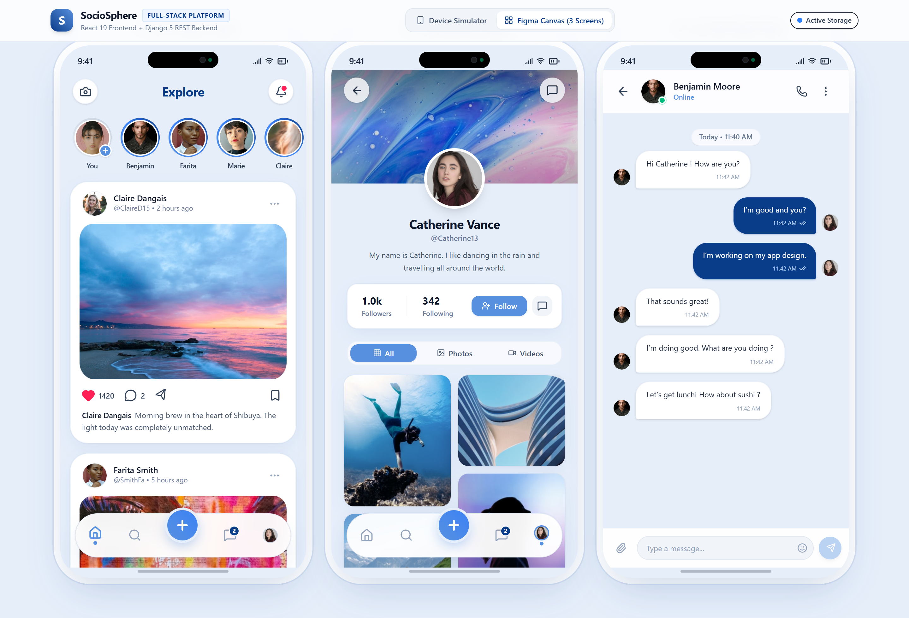
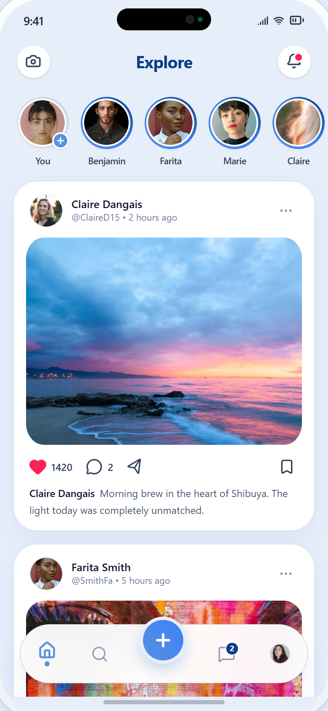
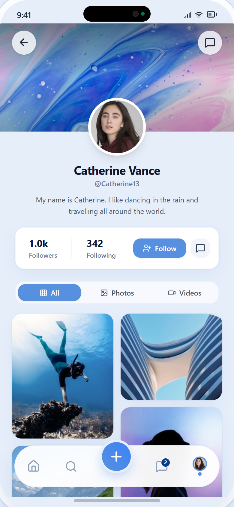
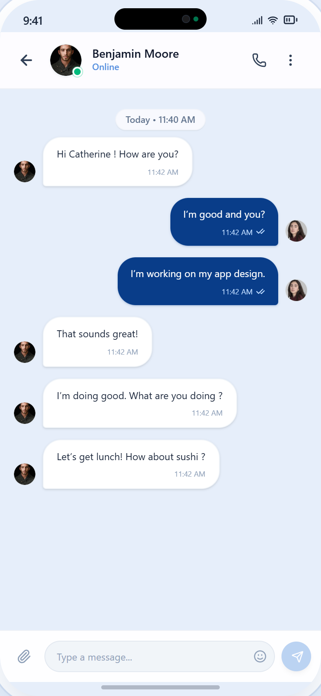
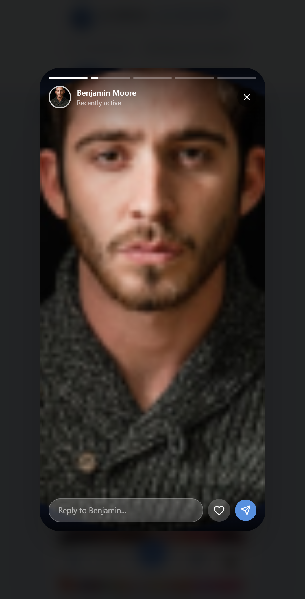
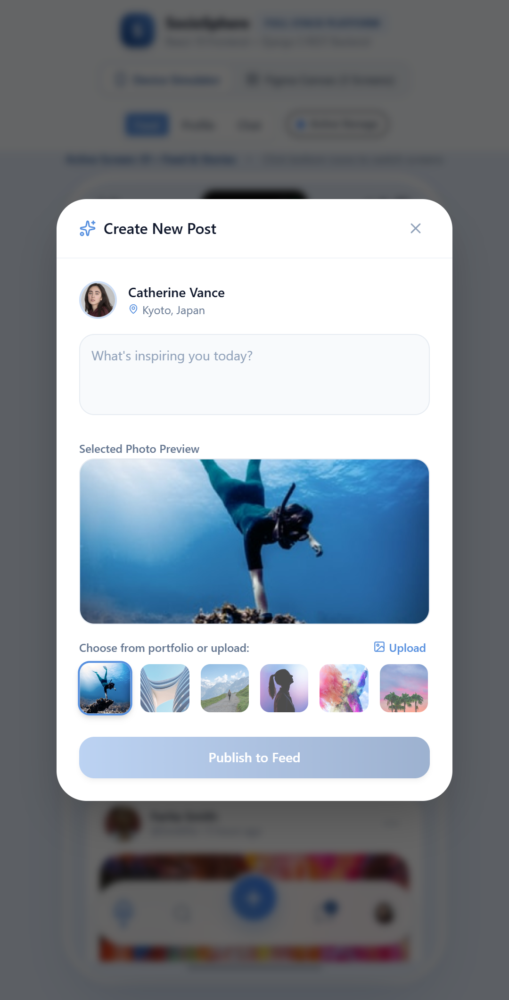

# SocioSphere — Full-Stack Social Media Platform

An enterprise-grade, pixel-perfect Full-Stack Social Media Application engineered with **React 19**, **Tailwind CSS v4**, and **Django 5 REST Framework**.

Built as a direct, zero-compromise translation of the Figma Design System (*"Social Media App — Community"*, Frame `17:789`), featuring an interactive mobile device simulator, tri-screen executive design canvas, dynamic feed, live stories, real-time interactive messaging, and asymmetric masonry galleries.

---

## Live Demo & Repository

- **Live Web Application**: [https://lxlnimalxl.github.io/sociosphere-social-platform/](https://lxlnimalxl.github.io/sociosphere-social-platform/)
- **GitHub Repository**: [https://github.com/lxlnimalxl/sociosphere-social-platform](https://github.com/lxlnimalxl/sociosphere-social-platform)
- **Figma Design Reference**: [Figma Community Design (Node 17:128)](https://www.figma.com/design/KOqTKnFmNReHoXgZ4rmS5z/Social-Media-App--Community-?node-id=17-128)

---

## Executive Canvas & Screens Preview

### 01. Multi-Screen Executive Canvas (Figma Frame 17:789)
Simultaneous tri-screen live interactive canvas showing Feed & Stories, Profile & Masonry, and Chat Room side-by-side.



---

### 02. Individual Mobile Screens

| 01. Explore & Feed | 02. User Profile & Masonry | 03. Live Chat Room |
| :---: | :---: | :---: |
|  |  |  |

---

### 03. Interactive Modals

| 04. Story Viewer Modal | 05. Create Post Modal |
| :---: | :---: |
|  |  |

---

## Key Features & Capabilities

### 1. Pixel-Perfect Figma Translation
- **Color Fidelity**: Strict extraction of primary `#5790DF`, navy `#093D89`, slate subtext `#6C7A9C`, and ice-blue canvas `#E6EEFA`.
- **Typography & Scale**: Poppins & Inter type scale matching Figma specifications down to 0.5px line heights and optical weights.
- **Micro-Interactions**: Floating pill tab bar with elevated center create button, animated story gradient rings, and heart pulse animations.

### 2. Dual Runtime Architecture
- **Online Mode**: Full integration with Django 5 REST Framework API endpoints (`/api/posts/`, `/api/stories/`, `/api/profiles/`, `/api/messages/`).
- **Edge / GitHub Pages Mode**: Seamless offline fallback via local persistence layer, allowing recruiters and evaluators to interact with all features (likes, comments, following, publishing posts, sending chat messages) live on GitHub Pages with zero server setup required.

### 3. Interactive Modals & Flows
- **Story Viewer**: Instagram-style progress bar timers, pause on press/hold, next/prev tapping, and reply input.
- **Create Post Modal**: Location selector, live photo chooser, caption editor, and celebration confetti via `canvas-confetti`.
- **Comments Drawer**: Bottom sheet modal showing threaded comments with instant author attribution.
- **Masonry Lightbox**: Full-resolution modal viewer for profile portfolio items.
- **Chat Simulation**: Interactive messaging thread with automated typing indicator and conversational auto-responses.

---

## Architecture & Technology Stack

```
sociosphere-social-platform/
├── backend/                  # Django 5 + Django REST Framework API
│   ├── core/                 # Settings, CORS headers, URL routing
│   ├── api/
│   │   ├── models.py         # UserProfile, Story, Post, Comment, ChatMessage
│   │   ├── serializers.py    # DRF Serializers
│   │   ├── views.py          # ViewSets with custom actions
│   │   ├── seed.py           # Pre-seeded database script with Figma personas
│   │   └── urls.py           # REST endpoints
│   ├── manage.py
│   └── db.sqlite3            # Fully migrated SQLite database
│
└── src/                      # React 19 Frontend + Vite
    ├── assets/images/        # 18 exported high-resolution Figma assets
    ├── components/
    │   ├── layout/           # DeviceFrame (iPhone 14/15 bezel & status bar)
    │   ├── screens/          # HomeScreen, ProfileScreen, ChatRoomScreen, ExecutiveCanvas
    │   └── modals/           # StoryViewerModal, CommentsModal, CreatePostModal, LightboxModal
    ├── services/             # Hybrid API Client (Django REST + LocalStorage Fallback)
    ├── App.jsx               # Application root & view mode switch
    └── main.jsx
```

### Technology Matrix
- **Frontend Framework**: React 19 + Vite 8
- **Styling**: Tailwind CSS v4 + Custom Design Tokens
- **Icons & Animation**: Lucide React + Canvas Confetti
- **Backend Framework**: Python 3.13 + Django 5.2 + Django REST Framework
- **Cross-Origin Security**: django-cors-headers
- **Testing & Verification**: Puppeteer Core automated multi-viewport capture

---

## Getting Started

### 1. Frontend Setup
```bash
# Clone the repository
git clone https://github.com/lxlnimalxl/sociosphere-social-platform.git
cd sociosphere-social-platform

# Install dependencies
npm install

# Run Vite development server
npm run dev
```

### 2. Backend Setup (Optional for Local REST Evaluation)
```bash
cd backend

# Create & activate virtual environment (optional)
python -m venv venv
# On Windows:
.\venv\Scripts\activate

# Install requirements
pip install django djangorestframework django-cors-headers

# Run database migrations & seed initial Figma data
python manage.py migrate
python manage.py shell -c "from api.seed import run_seed; run_seed()"

# Start Django development server
python manage.py runserver
```

---

## License
MIT License. Created by [Seyyed Nima Rounaghi](https://github.com/lxlnimalxl) as an international portfolio project.
